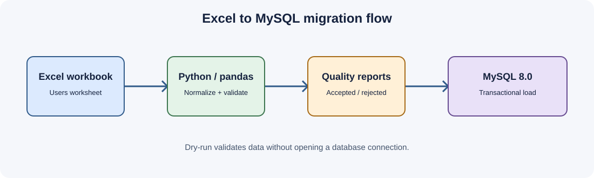
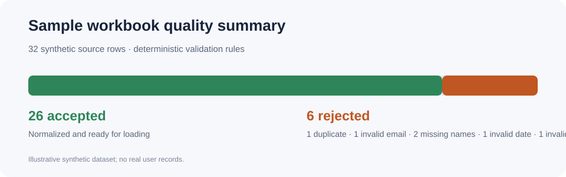

# Excel to SQL: Users Migration

[](https://github.com/agustiininicabral/excel-to-sql-users-migration/actions/workflows/ci.yml)

A reproducible practice project migrating synthetic user records from Excel to **MySQL 8.0**. It demonstrates spreadsheet ingestion, normalization, validation, deduplication, relational constraints, transactional loading, and quality reporting.

> Educational portfolio project. All records are synthetic; this is not a production migration service.

## Quick start
```bash
python -m venv .venv
# Windows: .venv\Scripts\activate
# macOS/Linux: source .venv/bin/activate
python -m pip install -r requirements.txt
python scripts/generate_sample_workbook.py
```

Validate without a database:
```bash
PYTHONPATH=src python -m migration.main --dry-run --input data/source/users_source.xlsx
```

Create the MySQL schema and load:
```bash
mysql -u root -p < sql/001_create_schema.sql
# Copy .env.example to .env and configure local credentials.
PYTHONPATH=src python -m migration.main --input data/source/users_source.xlsx
```

## Visual overview





## Quality rules
| Condition | Action |
|---|---|
| Whitespace / mixed casing | Trim text; lowercase email and status |
| Invalid email | Reject |
| Missing first or last name | Reject |
| Unsupported status | Reject |
| Invalid date | Reject |
| Duplicate normalized email | Keep first valid row; reject later rows |
| Empty phone | Store as NULL |

Allowed statuses: `active`, `inactive`, `pending`.

## Contents
`data/` synthetic source and workbook; `src/` cleaning, configuration, loader and CLI; `sql/` MySQL schema and validation queries; `tests/` automated tests; `docs/` design and quality documentation.

Run tests with `pytest`. GitHub Actions starts an ephemeral MySQL 8.0 service, generates the workbook, runs tests and a dry-run, applies the schema, performs the real load, and verifies persisted row counts and data-quality constraints. `scripts/apply_schema.py` and `scripts/verify_database.py` make the database checks reproducible.

## Limitations
Single worksheet and small synthetic dataset. The first-valid-row duplicate policy is illustrative. A real migration needs an approved survivorship rule, source snapshot, backups, reconciliation, structured logging, secret management, and a tested rollback plan. No real personal data is included.
